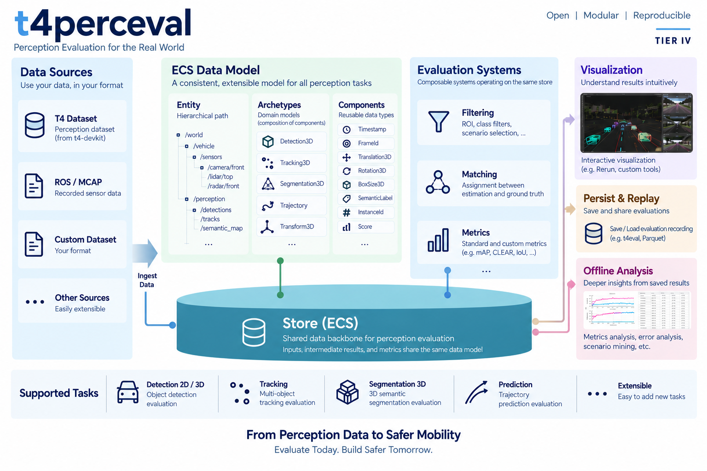

# t4perceval

[](https://ktro2828.github.io/t4perceval/)
[](pyproject.toml)
[](LICENSE)



**Component-oriented perception evaluation for the [T4 dataset](https://github.com/tier4/t4-devkit).**

A redesign of [`autoware_perception_evaluation`](https://github.com/tier4/autoware_perception_evaluation)
around [rerun](https://github.com/rerun-io/rerun)'s data model: data lives at an **entity path**, is
made of **component** columns, is bundled into **archetypes**, stored as **chunks**, indexed along
**timelines** inside a **store**, and transformed by **systems**.

The point of the redesign is that an evaluation task stops being a value to branch on. There is no
`EvaluationTask` enum and no single config dict — **a task is the set of components present plus the
pipeline you compose**.

> [!WARNING]
> Under active development. APIs and data layouts may change without backward compatibility until
> the design stabilizes.

## What it solves

`autoware_perception_evaluation` modelled one detected object as one Python object with twenty-plus
fields, most of them `None` for any given task. Four problems followed, and this package is the
answer to all four:

| Problem                                                              | What `t4perceval` does                                                            |
| :------------------------------------------------------------------- | :-------------------------------------------------------------------------------- |
| Per-object Python loops                                              | one frame is a set of NumPy columns; metrics are vectorized                       |
| An `EvaluationTask` enum branching through config, matching, metrics | a system declares the components it needs and runs against anything carrying them |
| Filter and matching intermediates discarded                          | every stage writes its result back as a queryable entity                          |
| Plausible-but-wrong numbers                                          | cross-frame comparison, bad pipeline order and registry mismatches all raise      |

## Supported evaluation tasks

| Task          | Matching                                                              | Metrics                                                                       |
| :------------ | :-------------------------------------------------------------------- | :---------------------------------------------------------------------------- |
| Detection 3D  | centre distance, centre distance BEV, plane distance, IoU BEV, IoU 3D | AP, APH, mAP, mAPH, confusion matrix                                          |
| Detection 2D  | ROI IoU                                                               | AP, mAP, classification, confusion matrix                                     |
| Tracking      | any 3D or 2D matcher                                                  | MOTA, MOTP, ID switches                                                       |
| Prediction    | any 3D matcher, on the current pose                                   | ADE, FDE, miss rate                                                           |
| Segmentation  | _not applicable_ (rows are aligned)                                   | IoU, mIoU, class accuracy, pixel accuracy, confusion matrix                   |
| FP validation | any matcher, with `agnostic_classes` for the annotation class         | pass rate of annotated false positives, per instance too                      |
| Sensing       | _not applicable_ (points inside ground-truth boxes)                   | detection verdict per box, points left in non-detection areas, detection rate |

Inputs come from your own arrays, from a **T4 dataset**, or from an **MCAP ROS bag**.

## Install

```bash
pip install 'git+https://github.com/ktro2828/t4perceval'
```

Importers are optional extras — the evaluation core never imports them:

```bash
pip install 't4perceval[t4]'       # read a T4 dataset
pip install 't4perceval[rosbag]'   # read an MCAP ROS bag (no ROS installation needed)
```

Python 3.10+.

## Example

```python
from t4perceval import (
    FRAME,
    Detections3D,
    LabelRegistry,
    MatchResults,
    MetricValues,
    Store,
    TimePoint,
    TimeRange,
)
from t4perceval.system import Pipeline, SystemContext, average_precision_sweep

labels = LabelRegistry.from_names(["car", "pedestrian"])
store = Store()

# One frame of objects is one columnar batch, not a list of objects.
store.log(
    "/ground_truth/objects",
    Detections3D(
        position=[[0.0, 0.0, 0.0], [10.0, 0.0, 0.0]],
        quaternion=[[0.0, 0.0, 0.0, 1.0]] * 2,
        size=[[1.9, 4.5, 1.6]] * 2,
        class_id=labels.encode(["car", "car"]),
        confidence=[1.0, 1.0],
    ),
    at=TimePoint.at(frame=0, timestamp_ns=1_624_164_470_849_887_000),
    frame_id="base_link",
)
store.log(
    "/estimation/objects",
    Detections3D(
        position=[[0.3, 0.0, 0.0], [50.0, 0.0, 0.0]],
        quaternion=[[0.0, 0.0, 0.0, 1.0]] * 2,
        size=[[1.9, 4.5, 1.6]] * 2,
        class_id=labels.encode(["car", "car"]),
        confidence=[0.9, 0.4],
    ),
    at=TimePoint.at(frame=0, timestamp_ns=1_624_164_470_849_887_000),
    frame_id="base_link",
)

# The task is the pipeline. Each stage writes its result back into the store.
Pipeline(
    average_precision_sweep("/estimation/objects", "/ground_truth/objects", thresholds=[1.0, 2.0])
).run(SystemContext(store, FRAME, labels=labels), TimeRange.everything())

# Aggregate over a whole scene...
scene = store.range(
    "/matching/center_distance/0", timeline=FRAME, time_range=TimeRange.everything()
).materialize(MatchResults)
print(scene.num_tp, scene.num_fp, scene.num_fn)  # 1 1 1

# ...or ask about one frame, from the same store, with no recomputation.
print(
    store.range("/metrics/map", timeline=FRAME, time_range=TimeRange.everything())
    .materialize(MetricValues)
    .aggregate
)
```

Every intermediate is still there afterwards — the filter masks, the matching verdicts, the
per-threshold AP — so "why is this number low?" is a query rather than a re-run.

## Benchmark

`benchmarks/compare.py` feeds `autoware_perception_evaluation` (`perception_eval` 1.3.6) and
`t4perceval` the same synthetic scenes and compares both speed and the metric values themselves.

```bash
uv run python benchmarks/compare.py --check
```

Scene phases run over 10 frames with 200 objects per frame (median of 5 runs after 2 warm-ups, one
pinned logical CPU); matching is a single frame.

| Workload (200 objects / frame)               | `perception_eval` | `t4perceval` |   Improvement |
| :------------------------------------------- | ----------------: | -----------: | ------------: |
| Data-model construction, one frame           |          6.035 ms |     0.069 ms |  87.2x faster |
| Center-distance matching, one frame          |        339.900 ms |     1.517 ms | 224.1x faster |
| Detection: mAP + mAPH at 4 thresholds        |       6360.713 ms |    94.074 ms |  67.6x faster |
| Tracking: CLEAR (MOTA / MOTP / ID switches)  |       3303.261 ms |    19.573 ms | 168.8x faster |
| Prediction: ADE / FDE / miss rate, top-k 1,3 |       3718.902 ms |    30.701 ms | 121.1x faster |
| Retained RSS, 20,000 est / 20,000 GT         |          83.7 MiB |      5.2 MiB | 16.0x smaller |

Numerical agreement is checked on two scenes. On the **unambiguous** scene all 133 compared values
agree to within `1e-9`. On the **dense** scene the two differ on 65 values, every one of which is
classified against a [documented divergence](docs/evaluation/metric-divergences.md); `--check`
fails on any difference that is not.

- Full report: [`benchmarks/results/latest.md`](benchmarks/results/latest.md)
- Narrative: [benchmarks/README.md](benchmarks/README.md)
